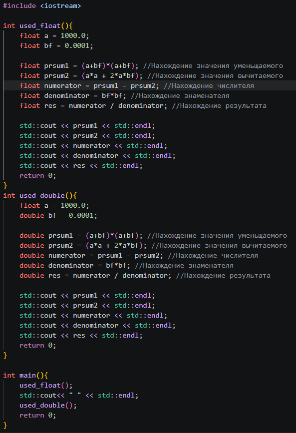

# При использовании Float
| (a+b)^2 | a^2 + 2ab | (a+b)^2 - a^2 - 2ab | b^2 | ((a+b)^2 - a^2 - 2ab)/b^2 |
| --- | --- | --- | --- | --- |
|1e+06|1e+06|0.0625|1e-08|6.25e+06|

# При использовании Double
| (a+b)^2 | a^2 + 2ab | (a+b)^2 - a^2 - 2ab | b^2 | ((a+b)^2 - a^2 - 2ab)/b^2 |
| --- | --- | --- | --- | --- |
|1e+06|1e+06|1.00117e-08|1e-08|1.00117|

Разница появилась ввиду разной точности типов данных. Из-за большого значения, точность числа с типом Float сильно исказилось точность малых разрядов. Это привело к сильным различиям между float и double 