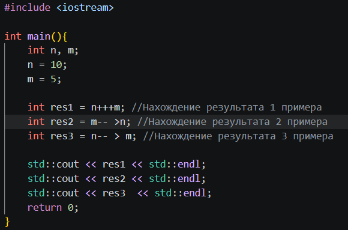

Зададим переменным n и m произвольные значения, например 10 и 5 соответствено. Результаты и значения n и m после выполнения операций приведены в таблице:
| № | Операция |Результат | n | m |
| --- | --- |--- | --- | --- |
| 1 | n+++m |15 | 11 | 5 |
| 2 | m-- >n |0 (false) | 11 | 4 |
| 3 | n-- > m |1 (true)| 10 | 4 |

### Объяснение результатов
В первом примере сначала вычисляется сумма чисел n и m, потом к n добавляется 1. Числа, несмотря на больший приоритет постфиксного инкремента, сначала складываются потому что постфиксный инкремент увеличивает число на 1 только после выполнения всех других операций над этим числом

Во втором примере числа n и m сначала сравниваются, потом от m отнимается 1. Числа, несмотря на больший приоритет постфиксного декремента, сначала складываются потому что постфиксный декремент уменьшает число на 1 только после выполнения всех других операций над этим числом

В третьем примере числа n и m сначала сравниваются, потом от n отнимается 1. Числа, несмотря на больший приоритет постфиксного декремента, сначала складываются потому что постфиксный декремент уменьшает число на 1 только после выполнения всех других операций над этим числом